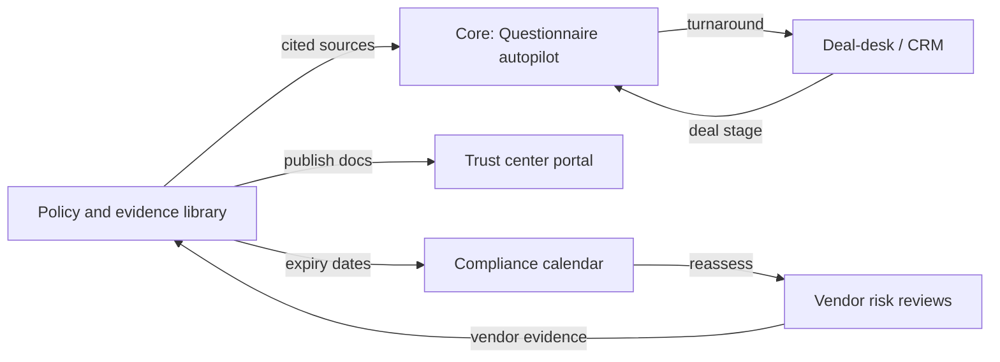
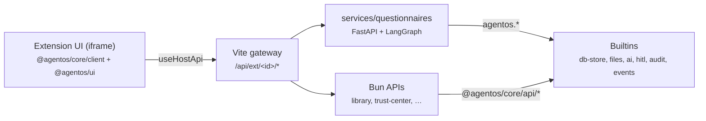
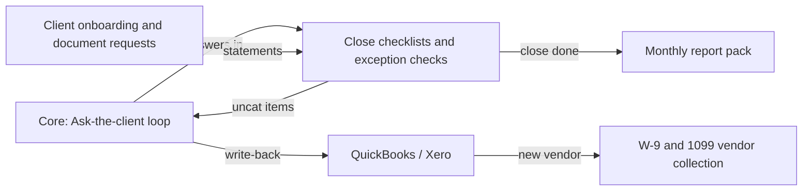
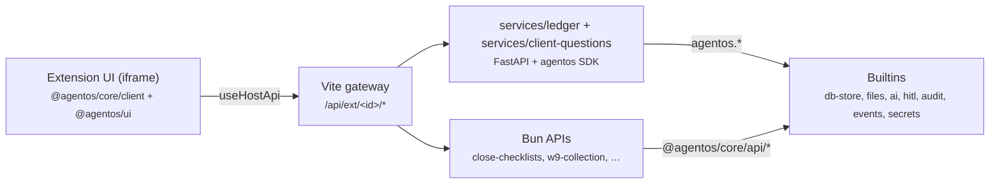
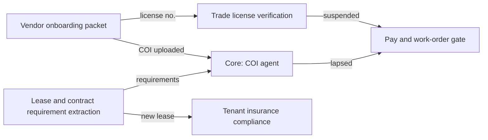
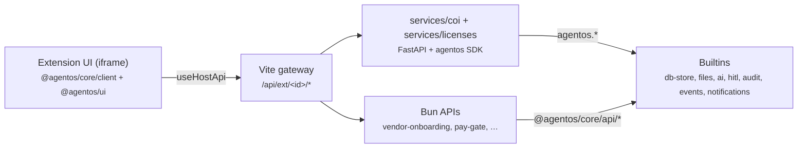
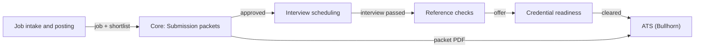
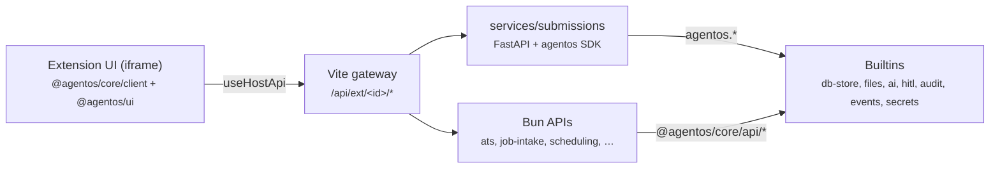
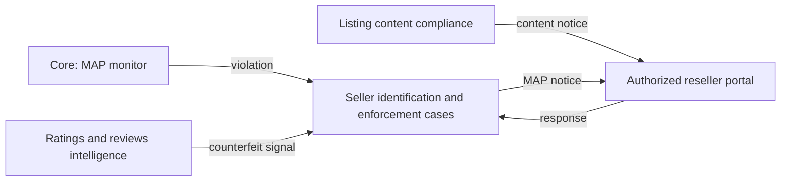
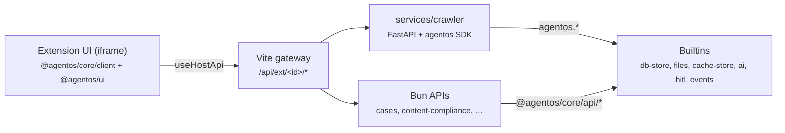

# Portfolio briefs: 5 one-stop platforms built on real business problems

Five project briefs for a freelance AI full-stack and forward deployed engineer. Each starts from one painful workflow a buyer already pays to solve, then grows into a platform of connected modules on shared data, with requirements, metrics, architecture and a solo-friendly roadmap.

## On this page

- [Compare the 5 platforms](#compare-the-5-platforms)
- [The shared platform layer](#the-shared-platform-layer)
- [1. TrustDesk (B2B SaaS trust)](#1-trustdesk-customer-trust-platform-for-b2b-saas)
- [Building TrustDesk on agentos](#building-trustdesk-on-agentos)
- [2. CloseDesk (bookkeeping firms)](#2-closedesk-client-operations-platform-for-bookkeeping-firms)
- [Building CloseDesk on agentos](#building-closedesk-on-agentos)
- [3. VendorGate (property managers)](#3-vendorgate-vendor-and-insurance-compliance-platform-for-property-managers)
- [Building VendorGate on agentos](#building-vendorgate-on-agentos)
- [4. PlacementOS (staffing agencies)](#4-placementos-job-to-placement-workspace-for-staffing-agencies)
- [Building PlacementOS on agentos](#building-placementos-on-agentos)
- [5. ChannelGuard (consumer brands)](#5-channelguard-channel-integrity-platform-for-consumer-brands)
- [Building ChannelGuard on agentos](#building-channelguard-on-agentos)
- [Cross-platform framework gaps](#cross-platform-framework-gaps)
- [Why FDE skills are in demand](#why-fde-skills-are-in-demand)
- [Sources](#sources)

## Compare the 5 platforms

| Platform        | Buyer                | Modules  | Effort      | Order     |
| --------------- | -------------------- | -------- | ----------- | --------- |
| 1. TrustDesk    | B2B SaaS GRC / sales | Core + 5 | 9 to 12 wks | Start 1st |
| 2. CloseDesk    | Bookkeeping firms    | Core + 4 | 9 to 11 wks | Start 2nd |
| 3. VendorGate   | Property managers    | Core + 5 | 9 to 12 wks | 3rd       |
| 4. PlacementOS  | Staffing agencies    | Core + 4 | 9 to 11 wks | 4th       |
| 5. ChannelGuard | Consumer brands      | Core + 4 | 9 to 12 wks | 5th       |

- **1. TrustDesk** · _High fit_ — FDE fit high: CRM, Drive, Slack and SSO integrations. Buyers pay separately for questionnaires, trust centers and vendor risk.
- **2. CloseDesk** · _High fit_ — FDE fit high: lives inside QuickBooks/Xero. Firms pay per client or per seat for each step today.
- **3. VendorGate** · _Medium-high_ — FDE fit medium-high: PMS and accounting sync. COI, onboarding, license and tenant tools sold separately.
- **4. PlacementOS** · _High fit_ — FDE fit high: ATS and calendar integrations. Point tools for each step of the placement.
- **5. ChannelGuard** · _Medium_ — FDE fit medium: mostly scraping and data. Price, review and enforcement tools sold separately.

> **Start order unchanged: 1, then 2.**
>
> The expansion strengthens both. TrustDesk's modules all reuse one document library and questionnaire engine, and CloseDesk's all reuse one ledger connection, so each new module is mostly new screens on existing data. Effort figures are estimates for one engineer, MVP through V2.

## The shared platform layer

Build this once in V1 and reuse it across all five. It is what turns a tool into a platform clients can grow into.

1. **Tenants and data isolation** — One Postgres schema, a tenant id on every row, row-level security policies enforced in the database.
2. **Roles and SSO** — Role-based access per module, external users on signed expiring links, SAML/OIDC SSO through a hosted provider.
3. **Audit log** — Append-only table of who did what, when and from where, shown per record and exportable.
4. **Event bus** — Write domain events to an outbox table in the same transaction; workers (SQS on AWS or Cloud Tasks on GCP) run cross-module automations.
5. **Integrations hub** — One place for OAuth connections, sync state, retries and webhooks, shared by every module.
6. **Agent layer** — LangGraph graphs per task with a shared human-review queue, prompt versions and evaluation logs.

## 1. TrustDesk: customer trust platform for B2B SaaS

B2B SaaS companies selling upmarket face security questionnaires, NDA-gated document requests, their own supplier reviews and audit deadlines, usually handled by one or two people with spreadsheets. Zapier's GRC lead said her team spent 50 to 60% of its time on questionnaires; a Drata customer described one compliance person handling vendor onboarding, client reviews, questionnaires and reassessments by hand. Buyers already pay separately for each piece: Vanta lists its Trust Center module at $6,000 a year and third-party risk at $13,600 a year for a 1 to 20 person company.

- **Buyer:** Head of Security / GRC lead, or VP Sales at a 20 to 300 person SaaS company
- **Users:** Solutions architects and AEs, security reviewers, GRC lead, procurement, and the customer's security reviewers (external)
- **Current workaround:** A shared answer spreadsheet, a Google Drive folder of PDFs sent by email after an NDA, a vendor-review spreadsheet and calendar reminders.
- **Why it falls short:** The same facts (policies, SOC 2 report, pen test dates) live in four places, go stale at different times, and nobody sees security review status on the deal.
- **Core wedge:** Questionnaire autopilot: upload an Excel/Word questionnaire, get cited draft answers, route low-confidence ones to a reviewer, export in the original format.

### Added modules

| Module                      | What it does                                                                                                    | Pain / demand                                                                                                                                            |
| --------------------------- | --------------------------------------------------------------------------------------------------------------- | -------------------------------------------------------------------------------------------------------------------------------------------------------- |
| Trust center portal         | Public security page plus NDA-gated SOC 2, pen test and policies, with access requests and approvals            | Vanta lists Trust Center at $6,000 a year (AWS Marketplace); SafeBase's reported median contract was $14,416 a year (Scrutineer)                         |
| Policy and evidence library | One versioned home for policies, reports and certificates with expiry dates; feeds answers and the trust center | A vendor review template tells reviewers to record each document's date, since an old pen test is not current evidence (rfp-software-tools.com)          |
| Vendor risk reviews         | Tier your own suppliers, send them a lite or full questionnaire, read their SOC 2, record residual risk         | Vanta lists third-party risk at $13,600 a year for up to 50 vendors; Wolters Kluwer describes TPRM run on spreadsheets with evidence expiry dates missed |
| Compliance calendar         | Deadlines for audit periods, pen tests, policy reviews and vendor reassessments, with owners and reminders      | Same evidence-expiry problem; deadlines come straight from the library's dates                                                                           |
| Deal-desk handoff           | Security review status, files shared and questionnaire turnaround on the CRM opportunity                        | Drata's trust center tiers sell Salesforce and HubSpot integrations as a paid step up (Scrutineer)                                                       |

### How the modules connect



Shared data: organizations (customers and vendors), documents and versions, controls, approved answers, deals, tasks, audit log

- A policy is updated: every answer citing it is flagged for re-review and the trust center copy republishes.
- A CRM deal reaches the security-review stage: a questionnaire workspace and time-boxed trust center access are created.
- A supplier's SOC 2 report expires: a calendar task and a reassessment questionnaire go out using the same questionnaire engine in reverse.
- A questionnaire is exported: turnaround and reviewer are logged on the CRM opportunity.

### User stories by module

- Questionnaires: as a solutions architect, I upload a questionnaire and get a cited draft for every question; low-confidence items go to a reviewer.
- Trust center: as a prospect's security reviewer, I request access, accept a click-through NDA and download the SOC 2 without emailing anyone.
- Library: as a GRC lead, I upload a new policy version and see which answers and published documents it affects.
- Vendor risk: as a GRC lead, I add a supplier, the system tiers it from the data it touches, sends the right questionnaire and summarizes its SOC 2 exceptions.
- Calendar: as an owner, I get reminders before my audit period, pen test or vendor reassessment is due.
- Deal desk: as an AE, I see on the opportunity whether security review is done and what was shared.

### Non-functional requirements

- Multi-tenant with Postgres row-level security; per-tenant encryption keys for uploaded reports.
- Roles: admin, reviewer, sales, read-only, external viewer; SSO (SAML/OIDC) from V1.
- Immutable audit log of approvals, downloads and NDA acceptances.
- No customer documents used for model training; configurable model provider and region.
- Integrations: Google Drive/Notion, Slack, Salesforce/HubSpot, DocuSign-style e-sign.
- Never answer without a citation; uncited drafts are flagged, not guessed.

### Success metrics to measure

| Metric                                    | How to measure / target                    |
| ----------------------------------------- | ------------------------------------------ |
| Questions drafted with a cited source     | Target 70%+ on a real past questionnaire   |
| Turnaround per questionnaire              | Baseline from the client, target a 50% cut |
| Security docs shared via portal vs email  | Target most requests self-served           |
| Vendor reassessments done on time         | Track per quarter                          |
| Deals with security status visible in CRM | Target all deals past the review stage     |

### Architecture on your stack

| Layer    | Choice                                                                                |
| -------- | ------------------------------------------------------------------------------------- |
| Frontend | Next.js on Vercel: app, review queue, public trust center pages (ISR)                 |
| API      | FastAPI on AWS ECS: parsing, exports, webhooks, CRM sync                              |
| Agents   | LangGraph: answer drafting with citations; SOC 2 exception summarizer; vendor tiering |
| Data     | Postgres + pgvector, row-level security per tenant; S3 for documents                  |
| Events   | Postgres outbox table + SQS workers for cross-module automations                      |
| Caching  | Redis for answer cache, trust center page cache, rate limits                          |
| Auth     | SSO via a hosted provider (e.g. WorkOS or Auth0); signed links for external viewers   |

### Roadmap (solo, estimates)

| Phase              | What ships                                                                         |
| ------------------ | ---------------------------------------------------------------------------------- |
| MVP (2 weeks)      | Questionnaire autopilot: upload, cited drafts, review, Excel export                |
| V1 (+3 to 4 weeks) | Policy and evidence library, trust center portal, tenants, roles, audit log, SSO   |
| V2 (+4 to 6 weeks) | Vendor risk reviews, compliance calendar, CRM deal-desk sync, all four automations |

Cut if short: If short on time, ship the trust center without NDA e-sign (click-through only) and leave CRM sync as a webhook stub.

### Demo and case study

1. **Data** — The free CSA CAIQ v4.1 questionnaire, a synthetic policy set for a fictional SaaS, and a fictional supplier SOC 2 summary you write.
2. **Video (4 min)** — Update a policy, watch two answers flag stale and the trust center republish; then a CRM deal stage change opens a questionnaire workspace.
3. **Case study** — Show the single data model and one event flowing across modules, plus measured draft coverage on the CAIQ.

### What the platform lets you pitch

Moves the pitch from a one-off questionnaire tool to owning a startup's whole customer-trust workflow: a larger fixed-scope build, then a retainer to keep content, integrations and automations current.

- Conveyor from $9,600 a year; Loopio reported Vendr median $24,209 a year (complies.ai).
- Vanta module list prices on AWS Marketplace: Trust Center $6,000, TPRM $13,600, Questionnaire Automation $10,000 a year for small companies.
- Drata customer story: a 196-question questionnaire could take days, with 20 to 30 a year handled manually (drata.com).

## Building TrustDesk on agentos

How TrustDesk maps onto your agentos framework repo as it stands today: extensions for each module, one Python service for the AI work, and builtins for data, approvals, audit and events. Ports, ids and permission names below are proposals; durations are estimates.



### Module-to-agentos mapping

| Module                         | Extension id        | Backend                                                                                   | Builtins used                                                                      |
| ------------------------------ | ------------------- | ----------------------------------------------------------------------------------------- | ---------------------------------------------------------------------------------- |
| Questionnaire autopilot (core) | questionnaires      | Python service `services/questionnaires` (parsing, retrieval, LangGraph drafting, export) | db-store, files, ai (embed, generate_text), hitl, audit, events, cache-store, auth |
| Policy and evidence library    | library             | Bun API (CRUD, versions); calls the questionnaires service to ingest and embed            | db-store, files, events, audit, auth                                               |
| Trust center portal            | trust-center        | Bun API (access requests, approvals, document links)                                      | db-store, files, notifications, audit, auth; needs public routes (gap 59)          |
| Supplier security reviews      | supplier-reviews    | Bun API; reuses the questionnaire engine via the gateway                                  | db-store, files, hitl, notifications, events, audit                                |
| Compliance calendar            | compliance-calendar | Bun API (deadlines, owners)                                                               | db-store, notifications, events; needs a scheduler (gap 57)                        |
| CRM deal-status hand-off       | deal-desk           | Bun API, crm-helper pattern (`api/routes/tools/*`)                                        | secrets (CRM token), events, db-store, audit                                       |
| Platform layer                 | app root            | `ui/dashboard.tsx`, `agentos.config.ts`, `src/env.ts`                                     | auth (RBAC permissions such as `trustdesk.questionnaire.review`), audit, settings  |

A `meta.json` has a single `api` block (Bun or Python), so the AI-heavy core is a Python-backed extension and every other module is a Bun extension that calls it through `/api/ext/questionnaires/*`, never directly.

### Repo structure

```
# agentos create examples/trustdesk --template with-service
examples/trustdesk/
  agentos.config.ts            # defineConfig: auth flags, branding
  src/env.ts                   # createEnv({ extends: [platformKeys(), ...ext keys()] })
  src/main.tsx                 # mountShell(root, { dashboard })
  ui/dashboard.tsx             # Home: open questionnaires, review queue, expiring evidence
  public/logo.svg              # served at /_public/logo.svg
  extensions/
    questionnaires/
      meta.json                # { "name": "Questionnaires", "icon": "ClipboardText",
                               #   "api": { "language": "python",
                               #            "root": "../../services/questionnaires",
                               #            "port": 6201, "health": "/health" } }
      ui/page.tsx              # upload, run, review table (@agentos/ui Table, Badge)
      ui/sidebar.tsx           # questionnaire list + filters
      agent/tools.json         # draft_answers, request_answer_approval
      agent/instructions.md
    library/
      meta.json                # "api": { "language": "bun", "port": 6202, "routesDir": "api/routes" }
      ui/page.tsx
      api/env.ts               # export const keys = () => createEnv(...)
      api/server.ts            # createApp(); loadRoutes(app, routes); Bun.serve
      api/routes/documents/index.ts        # GET list, POST upload
      api/routes/documents/[id]/index.ts   # GET one, new version
    trust-center/              # Bun, port 6203 (V1)
    supplier-reviews/          # Bun, port 6204 (V2)
    compliance-calendar/       # Bun, port 6205 (V2)
    deal-desk/                 # Bun, port 6206 (V2): api/routes/tools/update_deal/index.ts
  services/
    questionnaires/
      pyproject.toml           # agentos = { path = "../../../../packages/python" }
      app/main.py              # app = create_app(); routes use auth.require_permissions
      app/parsing.py           # XLSX (openpyxl), DOCX (python-docx), PDF (pypdf)
      app/ingest.py            # chunk + agentos.ai.embed -> db-store "chunks"
      app/retrieval.py         # in-process vector index (see design decision)
      app/graph.py             # LangGraph: retrieve -> draft -> cite-check -> score
      app/export.py            # write answers back into the original file
      tests/
```

### Data model (db-store collections)

```
// db-store is a document store: one Drizzle "documents" table keyed by
// (collection, id) with a JSON "data" column. Clients call
// dbStore.collection(name).query/insert/update/delete; "where" is flat
// equality on data fields only. Every TrustDesk doc carries orgId.

// users, sessions, roles -> builtin auth (Better Auth + user_roles/role_permissions)
orgs            { name, slug, plan }
org_members     { orgId, userId, role: "admin" | "reviewer" | "sales" | "viewer" }

questionnaires  { orgId, title, customer, sourceFileKey, format: "xlsx" | "docx",
                  status: "parsing" | "drafting" | "in_review" | "exported",
                  dueDate, createdBy, counts: { total, drafted, approved } }
questions       { orgId, questionnaireId, ref: { sheet, row, col }, text, section }
answers         { orgId, questionnaireId, questionId, text, status:
                  "draft" | "needs_review" | "approved" | "rejected",
                  confidence, citations: [{ chunkId, sourceId, quote }],
                  approvalId, editedBy, version }
approved_answers{ orgId, questionText, answerText, sourceIds, lastUsedAt }

sources         { orgId, title, kind: "policy" | "soc2" | "pentest" | "faq",
                  fileKey, version, effectiveDate, expiresAt }
chunks          { orgId, sourceId, sourceVersion, text, page, embedding: number[] }
evidence_docs   { orgId, sourceId, shareable, ndaRequired }   // V1 trust center
reviews         { orgId, answerId, decision, reviewerId, note, at }
// audit -> builtin audit entries { action, actor, resource, meta, at }
// files -> builtin files blob keys "orgs/<orgId>/sources/<id>/<version>.pdf"
```

> **Design decisions to make**
>
> 1. Vector search: db-store has no vector type or similarity query, and customer code may not hold a database URL. MVP: store embeddings on chunk docs and keep an in-process index inside the Python service, rebuilt from db-store on start (fine for one org and a few thousand chunks). Later: a new `vector-store` builtin that owns pgvector, keeping the rule that only builtins hold credentials. 2) Tenancy: nothing in db-store or auth is org-aware, so MVP puts `orgId` on every doc and every query goes through one helper that adds it. 3) Approvals: hitl keeps approvals in memory, so the answer doc's `status` is the source of truth and hitl is only the review inbox.

### 2-week MVP build plan (core autopilot only)

| Day | Deliverable                                                                                                                                                   | Done when                                                                                          |
| --- | ------------------------------------------------------------------------------------------------------------------------------------------------------------- | -------------------------------------------------------------------------------------------------- |
| 1   | `agentos create examples/trustdesk --template with-service`; rename starter to questionnaires extension + service; branding; `trustdesk.*` permissions seeded | `agentos dev` runs; `/api/ext/questionnaires/health` returns ok; a viewer gets 403 on write routes |
| 2   | Source ingestion: upload policy PDFs to files builtin, parse, chunk, embed via `agentos.ai.embed`, save to `chunks`                                           | 3 sample policies produce chunks with non-stub embeddings (real model key configured)              |
| 3   | Retrieval: in-service vector index + `/search`; cache query embeddings in cache-store                                                                         | Top-5 results look right on 10 hand-written test questions                                         |
| 4   | Questionnaire parsing for XLSX and DOCX into `questions` with sheet/row refs                                                                                  | CSA CAIQ v4.1 parses; question count matches the file                                              |
| 5   | LangGraph graph: retrieve, draft, citation check, confidence score                                                                                            | 20 CAIQ questions drafted, each with a citation or flagged needs_review                            |
| 6   | Batch run with progress; `questionnaire.drafted` published to events; audit entries per run                                                                   | Full CAIQ run completes; progress visible in the UI                                                |
| 7   | Review UI in `ui/page.tsx`: filter by confidence, edit, approve; low-confidence answers create hitl approvals                                                 | Approving in the HITL inbox flips the answer to approved and writes an audit entry                 |
| 8   | Export answers back into the original XLSX/DOCX; approved answers saved to `approved_answers` for reuse                                                       | Exported file opens with answers in the right cells; a re-run reuses approved answers              |
| 9   | Evaluation on a 50-question labelled set; error handling; README with metrics                                                                                 | Cited-draft coverage and edit rate measured and written down                                       |
| 10  | Deploy demo: one container or VM (AWS or GCP) running the gateway, builtins and service, seeded with a fictional org; record the video                        | Public URL works with a demo login; 4-minute video recorded                                        |

Free, legal demo data: the CSA CAIQ v4.1 questionnaire plus a synthetic policy set written for a fictional SaaS company. Day 10 depends on a deploy path the framework does not have yet (gap 63), so budget extra time there (estimate: 1 to 2 days).

### Framework gaps and proposed tickets

| #   | Gap found in the repo                                                                     | Proposed ticket                                                                     |
| --- | ----------------------------------------------------------------------------------------- | ----------------------------------------------------------------------------------- |
| 53  | cache-store is in-memory (v1)                                                             | Redis backend for cache-store behind the same get/set/del API                       |
| 54  | No tenancy in db-store or auth                                                            | Org model in auth + org-scoped collections in db-store                              |
| 55  | db-store `where` is flat equality only; no sort, range, `in` or indexes                   | Query operators, sort and JSON indexes for Postgres dialect                         |
| 56  | No vector search                                                                          | New `vector-store` builtin (pgvector) with upsert/query, plus TS and Python clients |
| 57  | events is in-process SSE only; no durable delivery, retries or scheduled jobs             | Durable event queue + job/scheduler builtin (cron, retries)                         |
| 58  | hitl approvals are in memory and lost on restart; no callback on resolve                  | Persist approvals via db-store; publish `hitl.resolved` events                      |
| 59  | Shell gates every non-auth path; no unauthenticated extension pages                       | Public routes for extensions (trust center pages, share links)                      |
| 60  | auth has email/password, sessions and permission checks; no SSO or role admin API         | SAML/OIDC SSO + role and permission management endpoints                            |
| 61  | Python SDK covers auth, store, ai, hitl only; TS kit has no audit or notifications client | SDK parity: files, events, audit, secrets, notifications in both kits               |
| 62  | files builtin writes to a local temp directory; no list or metadata                       | S3/GCS backend, content type, list and metadata                                     |
| 63  | Gateway runs as Vite middleware (v1); no production runtime or container                  | Standalone gateway + process supervisor + Dockerfile and deploy guide               |
| 64  | `meta.json` allows one `api` per extension                                                | Allow an extension to have both a Bun API and a linked Python service               |

Follows the repo's open tickets 29 (end-to-end verification) and 30 (Next.js host adapter spike). For TrustDesk the order that matters is 54, 56, 58 and 63; the MVP works around the rest. New tickets 65 to 72 and a matrix across all five platforms follow the ChannelGuard section.

## 2. CloseDesk: client operations platform for bookkeeping firms

Bookkeeping firms juggle month-end close for dozens of clients: chasing transaction explanations and receipts, running close checks, collecting W-9s before 1099 season, requesting documents and sending a monthly report. Each step is often a separate per-client or per-seat tool (Uncat $9 per client a month, Collect1099 from $19 a month, Karbon from $59 per user a month, Aider from $150 a month), or done by email. Bookkeepers still describe chasing receipts as a nightmare.

- **Buyer:** Owner of a 3 to 30 person bookkeeping or accounting firm (US, UK, Australia)
- **Users:** Bookkeepers and reviewers; small-business clients answering on their phone; the clients' vendors submitting W-9s
- **Current workaround:** QuickBooks/Xero plus a spreadsheet checklist per client, email for questions and documents, and a January scramble for W-9s.
- **Why it falls short:** Client, vendor and transaction data are re-keyed across tools, and nobody sees which clients are blocking close until the last week.
- **Core wedge:** Ask-the-client loop: AI categorizes uncategorized transactions, sends the client one mobile link for the rest, and writes answers and receipts back to the ledger.

### Added modules

| Module                                  | What it does                                                                                                    | Pain / demand                                                                                                                                                                             |
| --------------------------------------- | --------------------------------------------------------------------------------------------------------------- | ----------------------------------------------------------------------------------------------------------------------------------------------------------------------------------------- |
| Close checklists and exception checks   | Per-client close templates with automated checks (reconciliation gaps, uncategorized balance, missing receipts) | Karbon/Aider sell close checks across QuickBooks Online and Xero; Aider starts at a $150 monthly minimum                                                                                  |
| W-9 and 1099 vendor collection          | Detect new vendors, request W-9s by secure link, validate, attach to the vendor record, prep 1099 data          | Collect1099 ($19 a month + $2 per client), SteadFile ($29 to $149 a month) and Avalara sell exactly this; a bookkeeper quoted: 'Every year I say I have to come up with a better process' |
| Client onboarding and document requests | Engagement checklist, bank statements, payroll and loan docs requested with reminders                           | Karbon bundles a client portal and automatic client reminders in its per-user plans                                                                                                       |
| Monthly report pack                     | P&L, cash and variance with AI-drafted commentary, sent through the client portal                               | Aider sells AI-powered management reports alongside close automation                                                                                                                      |

### How the modules connect



Shared data: firms, clients, ledger connections, transactions, vendors, documents, questions, checklists, audit log

- A close check finds uncategorized transactions: the ones AI can't resolve are batched into one client question link.
- A new vendor appears in QuickBooks/Xero: a W-9 request goes out and the reminder ladder starts.
- All client answers are in: the checklist step completes and the report pack is drafted.
- The reviewer approves close: the report pack is published to the client portal and the client is notified.

### User stories by module

- Ask client: as a bookkeeper, I send one link with only the transactions AI could not resolve; the client answers with a tap, note or receipt photo.
- Close: as a reviewer, I see every client's close progress and failing checks on one board.
- W-9: as a bookkeeper, new vendors trigger W-9 requests automatically and I see 1099 exposure per client.
- Onboarding: as a firm owner, a new client gets a checklist of documents to upload with reminders until done.
- Reports: as a client, I get a short monthly report with plain-English commentary in my portal.

### Non-functional requirements

- Multi-tenant per firm; client and vendor portals use signed, expiring, no-login links.
- Roles: owner, reviewer, bookkeeper, client user; firm-level SSO optional (Google/Microsoft).
- Audit log of every ledger write-back and approval; idempotent writes so retries never double-post.
- OAuth to QuickBooks/Xero with least-privilege scopes; encrypted tokens; TINs encrypted at rest and masked in the UI.
- PII minimized in LLM prompts; data region selectable.

### Success metrics to measure

| Metric                                           | How to measure / target                    |
| ------------------------------------------------ | ------------------------------------------ |
| Uncategorized items auto-resolved without asking | Target 50%+ per client                     |
| Days from month end to close                     | Baseline from the firm, then track monthly |
| Vendors with a W-9 on file by 31 Dec             | Target near 100%                           |
| Clients whose report pack ships on schedule      | Track monthly                              |
| Tools the firm can retire                        | Count before and after a pilot             |

### Architecture on your stack

| Layer    | Choice                                                                                   |
| -------- | ---------------------------------------------------------------------------------------- |
| Frontend | Next.js on Vercel: firm app, client portal, vendor W-9 page                              |
| API      | FastAPI on GCP Cloud Run: QBO/Xero sync, webhooks, write-back, PDF reports               |
| Agents   | LangGraph: categorization, ask-vs-post decision, W-9 field extraction, report commentary |
| Data     | Postgres (Cloud SQL) with row-level security per firm; GCS for documents                 |
| Events   | Postgres outbox + Cloud Tasks; Cloud Scheduler for nightly syncs and reminders           |
| Caching  | Redis (Memorystore) for vendor-category lookups and API rate limits                      |

### Roadmap (solo, estimates)

| Phase              | What ships                                                                        |
| ------------------ | --------------------------------------------------------------------------------- |
| MVP (2 weeks)      | QuickBooks sandbox sync, AI categorization, client link, approve and write back   |
| V1 (+3 to 4 weeks) | Close checklists and checks, W-9 collection, firm tenants, roles, audit log, Xero |
| V2 (+4 to 5 weeks) | Onboarding and document requests, report pack, client portal, all automations     |

Cut if short: If short on time, skip 1099 e-filing entirely (export data instead) and ship report commentary as a draft the bookkeeper edits.

### Demo and case study

1. **Data** — Intuit's free QuickBooks Online sandbox and Xero's demo company, plus fictional vendors for W-9 requests.
2. **Video (4 min)** — A close check fails, the client answers on a phone, the checklist goes green, the report pack drafts itself; a new vendor triggers a W-9 link.
3. **Case study** — Show how one client record drives four workflows, with share auto-resolved on sandbox data.

### What the platform lets you pitch

Lets you pitch firms on replacing several per-client tools with one system on their ledger, or white-label it for an accounting-tech startup or an outsourced bookkeeping agency serving many firms, with ongoing support retainers.

- Uncat: $9 a month per client (uncat.com); Dext per-client pricing with a missing-paperwork request (dext.com).
- Karbon: $59 to $89 per user a month; Aider close automation from a $150 monthly minimum (karbonhq.com, aider.ai).
- Collect1099: $19 a month for 5 clients plus $2 per extra client (collect1099.com).

## Building CloseDesk on agentos

How CloseDesk maps onto your agentos repo today, following the same conventions as TrustDesk. Ports, ids and permission names are proposals; durations are estimates.



### Module-to-agentos mapping

| Module                          | Extension id      | Backend                                                                                                                                           | Builtins used                                                                          |
| ------------------------------- | ----------------- | ------------------------------------------------------------------------------------------------------------------------------------------------- | -------------------------------------------------------------------------------------- |
| Ledger integration hub          | ledger            | Python service `services/ledger` (QuickBooks/Xero OAuth, sync, webhooks, idempotent write-back)                                                   | secrets, db-store, cache-store (rate limits), events, audit, auth                      |
| Ask-the-client loop (core)      | client-questions  | Python service `services/client-questions` (LangGraph categorization, question batches, client answer page); calls ledger via `/api/ext/ledger/*` | db-store, files (receipts), ai (generate_text), hitl, audit, events, cache-store, auth |
| Close checklists and checks     | close-checklists  | Bun API (templates, check runs)                                                                                                                   | db-store, events, notifications, audit                                                 |
| W-9 and 1099 collection         | w9-collection     | Bun API (requests, vendor link, TIN masking)                                                                                                      | db-store, files, ai, notifications, events, audit                                      |
| Client onboarding and documents | client-onboarding | Bun API (checklists, document requests)                                                                                                           | db-store, files, notifications, events                                                 |
| Monthly report pack             | report-pack       | Python service `services/report-pack` (P&L pull via ledger, PDF render, commentary)                                                               | db-store, files, ai, hitl, events                                                      |
| Platform layer                  | app root          | `ui/dashboard.tsx` (clients blocking close), `agentos.config.ts`, `src/env.ts`                                                                    | auth (roles: owner, reviewer, bookkeeper; permissions `closedesk.*`), audit, settings  |

The MVP builds two Python-backed extensions (ledger, client-questions); every later module is a Bun extension that reads ledger data through the gateway, never the provider APIs directly.

### Repo structure

```
# agentos create examples/closedesk --template with-service
examples/closedesk/
  agentos.config.ts            # auth flags, branding
  src/env.ts                   # extends platformKeys() + extension keys()
  ui/dashboard.tsx             # Home: clients blocking close, open question batches
  extensions/
    ledger/
      meta.json                # "api": { "language": "python", "root": "../../services/ledger",
                               #          "port": 6301, "health": "/health" }
      ui/page.tsx              # connections + last sync status
    client-questions/
      meta.json                # python, root ../../services/client-questions, port 6302
      ui/page.tsx              # review queue: suggestions, answers, approve write-back
      ui/sidebar.tsx           # clients list
      agent/tools.json         # categorize_transactions, send_question_batch
    close-checklists/          # Bun, port 6303 (V1): api/server.ts, api/routes/checklists/index.ts
    w9-collection/             # Bun, port 6304 (V1)
    client-onboarding/         # Bun, port 6305 (V2)
    report-pack/               # Python, port 6306 (V2) -> services/report-pack
  services/
    ledger/
      app/main.py              # create_app(); auth.require_permissions("closedesk.ledger")
      app/qbo.py               # OAuth 2.0 + Accounting API client
      app/sync.py              # pull accounts, purchases, deposits -> db-store
      app/webhooks.py          # verify provider signature, enqueue resync
      app/writeback.py         # idempotent recategorize + attach receipt
    client-questions/
      app/graph.py             # LangGraph: rules -> history -> LLM suggest -> confidence -> ask?
      app/batches.py           # build batch, signed token, expiry
      app/public.py            # token-checked mobile answer page (see decision 2)
      tests/
```

### Data model (db-store collections)

```
// One db-store "documents" table; flat equality filters; orgId on every doc.
orgs              { name }                                   // the firm
org_members       { orgId, userId, role: "owner" | "reviewer" | "bookkeeper" }
clients           { orgId, name, contactEmail, contactPhone, provider: "qbo" | "xero" }
ledger_connections{ orgId, clientId, provider, realmId, tokenRef, status, lastSyncAt }
accounts          { orgId, clientId, externalId, name, type, isAskClient }
transactions      { orgId, clientId, externalId, date, amount, payee, accountId, memo,
                    state: "uncategorized" | "suggested" | "asked" | "answered" | "posted",
                    suggestion: { accountId, confidence, reason } }
vendor_rules      { orgId, clientId, payeeKey, accountId, source: "history" | "answer" }
question_batches  { orgId, clientId, period, tokenHash, expiresAt, status }
questions         { orgId, batchId, transactionId, prompt, options }
answers           { orgId, questionId, transactionId, choice, note, receiptFileKey, answeredAt }
writebacks        { orgId, transactionId, status: "pending" | "done" | "failed", attempts }
                  // doc id = transactionId + suggestion version, so a retried insert collides
// V1/V2: checklists, check_results, vendors, w9_requests, doc_requests, report_packs
```

> **Design decisions to make**
>
> 1. Ledger tokens: the secrets builtin only reads values from env, so the MVP connects one sandbox company with its token in env; real per-client tokens need a per-tenant credential store (new ticket 66), not raw tokens in db-store docs. 2) Client link: the Shell puts every app page behind sign-in, but the gateway proxy does not check sessions itself, so the MVP serves a minimal token-checked answer page from the service at `/api/ext/client-questions/l/<token>`; the proper fix is public routes (59). 3) Write-back: db-store keys documents by (collection, id), so each write-back uses a deterministic id to stop retries double-posting.

### 2-week MVP build plan (ask-the-client loop only)

| Day | Deliverable                                                                                                                               | Done when                                                                  |
| --- | ----------------------------------------------------------------------------------------------------------------------------------------- | -------------------------------------------------------------------------- |
| 1   | `agentos create examples/closedesk --template with-service`; ledger + client-questions extensions and services; `closedesk.*` permissions | Both `/health` routes return ok via the gateway; viewer gets 403 on writes |
| 2   | QuickBooks OAuth against the Intuit sandbox in `services/ledger`; token in env via secrets                                                | Company info call succeeds from the service                                |
| 3   | Sync accounts and transactions into db-store; flag uncategorized and ask-my-accountant items                                              | Counts match the sandbox; uncategorized list correct                       |
| 4   | Categorization graph: vendor rules, history, LLM suggestion, confidence                                                                   | 40 hand-labelled sandbox transactions: precision recorded                  |
| 5   | Question batches for low-confidence items with signed, expiring tokens                                                                    | Batch link opens; expired token is refused                                 |
| 6   | Mobile answer page: choose, note, receipt photo to files                                                                                  | Answer from a phone lands in `answers` with the receipt                    |
| 7   | Review queue in `ui/page.tsx`; write-back approval through hitl; audit entries                                                            | Approving in the HITL inbox moves the item to posted-pending               |
| 8   | Idempotent write-back to QuickBooks with receipt attachment                                                                               | Sandbox transaction recategorized; a retry does not double-post            |
| 9   | Reminder for unanswered batches, firm dashboard, error handling                                                                           | Dashboard shows clients blocking close; reminder fires on schedule         |
| 10  | Deploy one container with gateway, builtins and both services; seeded demo firm; video                                                    | Public URL with demo login; 4-minute video recorded                        |

Demo data: Intuit's free QuickBooks Online sandbox (Xero's demo company in V1). Day 9 reminders run from a host cron hitting a service route until a scheduler exists (57); email delivery needs new ticket 65.

### Platform-specific needs

| Need                                            | Ticket     | MVP workaround / timing                      |
| ----------------------------------------------- | ---------- | -------------------------------------------- |
| QuickBooks/Xero OAuth connect and token refresh | New 66, 67 | MVP: one sandbox token in env                |
| Inbound ledger webhooks with signature checks   | New 67     | Verify the provider signature in the service |
| Nightly sync and reminder cadence               | 57         | Host cron calling a route                    |
| No-login client answer link                     | 59         | Token-checked page via the extension API     |
| Receipt storage                                 | 62         | Local files fine for the demo                |
| Email/SMS reminders to clients                  | New 65     | notifications builtin is in-app only         |
| Date-range queries on transactions              | 55         | Filter by state, then by date in the service |

## 3. VendorGate: vendor and insurance compliance platform for property managers

Property managers must confirm every vendor has current insurance, a W-9, a valid trade license and a signed agreement before work and payment, and must track tenants' insurance under their leases. In spreadsheets, certificates lapse unnoticed and audits ask for history that was overwritten. The market sells these as separate tools: COI tracking (BCS, TrustLayer, Certificial), vendor onboarding (OnComply from $29 a month), license checks (TrackMyVendor) and tenant insurance tracking (LeaseTrack, MRI).

- **Buyer:** Director of operations or risk at a property management firm with 50 to 2,000 vendors
- **Users:** Property coordinators, AP clerks, risk lead; vendors and tenants uploading documents
- **Current workaround:** Spreadsheets of expiry dates, Outlook reminders, emailed PDFs and a separate renters insurance process.
- **Why it falls short:** No one ties a lease or contract's insurance clause to the certificate actually received, or blocks payment when coverage lapses.
- **Core wedge:** COI agent: extract ACORD 25 fields with source highlights, check them against requirements, track expiry and chase renewals.

### Added modules

| Module                                    | What it does                                                                                          | Pain / demand                                                                                    |
| ----------------------------------------- | ----------------------------------------------------------------------------------------------------- | ------------------------------------------------------------------------------------------------ |
| Vendor onboarding packet                  | One link for W-9, COI, license, ACH form and signed agreement; vendor marked cleared to work and pay  | OnComply sells one-link onboarding with can-work/can-pay status from $29 to $999 a month         |
| Trade license verification                | Match HVAC, electrical and plumbing licenses against state databases and re-check for suspensions     | TrackMyVendor advertises automated license checks against state databases for a dozen states     |
| Lease and contract requirement extraction | Read insurance clauses from leases and vendor contracts and turn them into per-property requirements  | A buyer's guide notes myCOI lacks lease requirement matching as a standard feature (coifile.com) |
| Tenant insurance compliance               | Track renters and commercial tenant certificates against each lease, with lapse alerts                | LeaseTrack, Rent Manager and MRI all sell resident insurance tracking to property managers       |
| Pay and work-order gate                   | Sync compliance status to accounting/PMS so lapsed vendors are held from new work orders and payments | TrackMyVendor syncs compliance status to QuickBooks vendor records; OnComply enforces can-pay    |

### How the modules connect



Shared data: properties, leases and contracts, requirements, vendors, tenants, certificates (versioned), licenses, W-9s, audit log

- A contract or lease is uploaded: insurance requirements are extracted and applied to that vendor's or tenant's checks.
- A COI expires or a license is suspended: the vendor is marked not cleared and payments/work orders are held in the PMS or accounting system.
- A W-9 is approved: tax fields sync to the vendor record for year-end 1099s.
- A new lease is signed: the tenant gets an insurance upload request.

### User stories by module

- COI: as a coordinator, I upload an ACORD 25 and see limits, dates and additional-insured status with source highlights and a compliant/deficient verdict.
- Onboarding: as a vendor, I complete W-9, COI, license and agreement in one link without an account.
- Licenses: as a risk lead, I'm alerted when a vendor's license is suspended or expired.
- Requirements: as a risk lead, I upload a management agreement or lease and confirm the extracted insurance requirements.
- Tenants: as a property manager, I see which tenants lack required coverage.
- Gate: as an AP clerk, I can't pay a vendor whose coverage lapsed without an override that is logged.

### Non-functional requirements

- Multi-tenant per management company, with property-portfolio scoping inside each tenant.
- Roles: admin, risk lead, coordinator, AP, read-only owner/lender; SSO for larger firms.
- Immutable certificate history; any coverage viewable as of a past date for audits.
- Bank details and TINs encrypted and masked; step-up auth to view.
- Every extracted field links to its PDF location; low confidence needs human confirmation.
- Integrations: Gmail/Outlook inbox ingestion, QuickBooks, AppFolio or Yardi (V2).

### Success metrics to measure

| Metric                                         | How to measure / target            |
| ---------------------------------------------- | ---------------------------------- |
| Vendors cleared to work with current documents | Target 95%+                        |
| Coordinator minutes per vendor onboarding      | Baseline vs after                  |
| Payments made to non-compliant vendors         | Target zero, with logged overrides |
| Extraction field accuracy vs human review      | Target 95%+ on a labelled set      |
| Tenants with required coverage on file         | Track monthly                      |

### Architecture on your stack

| Layer    | Choice                                                                                    |
| -------- | ----------------------------------------------------------------------------------------- |
| Frontend | Next.js on Vercel: portfolio dashboard, vendor and tenant portals, requirement editor     |
| API      | FastAPI on AWS: SES inbox ingestion, PDF processing, PMS/accounting sync                  |
| Agents   | LangGraph: ACORD extraction, lease clause extraction, deficiency emails                   |
| Scraping | Playwright workers for state license lookups where no API exists, with polite rate limits |
| Data     | Postgres with row-level security; versioned certificate tables; S3 for PDFs               |
| Events   | Outbox + SQS; EventBridge schedules for daily expiry and license re-checks                |
| Caching  | Redis for license lookup results and dashboard rollups                                    |

### Roadmap (solo, estimates)

| Phase              | What ships                                                                                              |
| ------------------ | ------------------------------------------------------------------------------------------------------- |
| MVP (2 weeks)      | ACORD 25 extraction with highlights, requirement check, expiry dashboard                                |
| V1 (+3 to 4 weeks) | Vendor onboarding packet, license verification (2 to 3 states), tenants, roles, audit history           |
| V2 (+4 to 6 weeks) | Lease/contract extraction, tenant insurance, pay gate via QuickBooks, automations, vendor portal polish |

Cut if short: If short on time, verify licenses in one state only and replace the PMS sync with a CSV export of cleared vendors.

### Demo and case study

1. **Data** — Synthetic ACORD 25-style certificates, W-9s with fake TINs, sample lease clauses you write, and public state license lookup pages read politely.
2. **Video (4 min)** — Upload a contract, requirements appear; a vendor's COI fails one limit; the vendor fixes it via link; a suspended license puts the vendor on hold in QuickBooks sandbox.
3. **Case study** — Show one vendor record across five workflows and extraction accuracy on your labelled set.

### What the platform lets you pitch

Lets you sell a vendor-compliance system of record to property management, construction and facilities firms, or white-label it for insurance brokers who serve many such clients, with retainers for new states and PMS integrations.

- COI tools: BCS $0.95 per vendor a month, TrustLayer $10 per vendor over 50, Certificial from $99 a month (watchmycover.com).
- OnComply vendor onboarding $29 to $999 a month; TrackMyVendor $39 to $59 a month with state license checks.
- Resident insurance tracking sold by LeaseTrack (MSI) and Rent Manager.

## Building VendorGate on agentos

How VendorGate maps onto your agentos repo today, following the same conventions as TrustDesk. Ports, ids and permission names are proposals; durations are estimates.



### Module-to-agentos mapping

| Module                                | Extension id      | Backend                                                                                                    | Builtins used                                                                           |
| ------------------------------------- | ----------------- | ---------------------------------------------------------------------------------------------------------- | --------------------------------------------------------------------------------------- |
| COI checker (core)                    | coi               | Python service `services/coi` (PDF text and layout, field extraction, requirement check, renewal requests) | db-store, files, ai (generate_text), hitl, audit, events, notifications, auth           |
| Vendor onboarding packet              | vendor-onboarding | Bun API (vendor link, document checklist, cleared status); W-9 parsing via the coi service                 | db-store, files, notifications, events, audit                                           |
| Trade license verification            | licenses          | Python service `services/licenses` (headless-browser lookups on public state pages)                        | db-store, cache-store, events, audit                                                    |
| Lease/contract requirement extraction | requirements      | Bun API (requirement editor) calling `/api/ext/coi/extract-requirements`                                   | db-store, files, hitl, audit                                                            |
| Tenant insurance compliance           | tenant-insurance  | Bun API (tenant certificates per lease)                                                                    | db-store, files, notifications, events                                                  |
| Pay and work-order gate               | pay-gate          | Bun API (QuickBooks vendor status sync, override log)                                                      | secrets, events, db-store, hitl (override approval), audit                              |
| Platform layer                        | app root          | `ui/dashboard.tsx` (vendors on hold, expiring this month)                                                  | auth (roles: admin, risk, coordinator, ap; permissions `vendorgate.*`), audit, settings |

Extraction lives in one Python service that other modules call; the license checker is a separate Python service because headless browsing has a different runtime footprint.

### Repo structure

```
# agentos create examples/vendorgate --template with-service
examples/vendorgate/
  agentos.config.ts
  src/env.ts
  ui/dashboard.tsx             # Home: vendors on hold, certificates expiring in 30 days
  extensions/
    coi/
      meta.json                # "api": { "language": "python", "root": "../../services/coi",
                               #          "port": 6401, "health": "/health" }
      ui/page.tsx              # upload, verdicts, deficiency list
      ui/sidebar.tsx           # vendors + filters
      agent/tools.json         # check_certificate, request_renewal
    vendor-onboarding/         # Bun, port 6402 (V1)
    licenses/                  # Python, port 6403 (V1) -> services/licenses
    requirements/              # Bun, port 6404 (V2)
    tenant-insurance/          # Bun, port 6405 (V2)
    pay-gate/                  # Bun, port 6406 (V2): api/routes/vendors/[id]/hold/index.ts
  services/
    coi/
      app/main.py
      app/pdf.py               # pdfplumber: words + coordinates per page, page PNGs
      app/extract.py           # prompt -> JSON -> pydantic validation + field sources
      app/rules.py             # deterministic requirement checks (limits, dates, AI wording)
      app/renewals.py          # renewal request + upload token
      app/synthetic.py         # generate ACORD 25-style test certificates (demo only)
      tests/
    licenses/                  # V1: Playwright lookups, cached results
```

### Data model (db-store collections)

```
// One db-store "documents" table; flat equality filters; orgId on every doc.
orgs             { name }
org_members      { orgId, userId, role: "admin" | "risk" | "coordinator" | "ap" }
properties       { orgId, name, address, portfolio }
vendors          { orgId, name, trade, email, status: "onboarding" | "cleared" | "hold" }
requirements     { orgId, scope: "default" | "property" | "contract", propertyId,
                   coverages: [{ type: "GL" | "Auto" | "WC" | "Umbrella", eachOccurrence, aggregate }],
                   additionalInsured, waiverOfSubrogation }
certificates     { orgId, vendorId, version, fileKey, status: "current" | "superseded",
                   extracted: { insured, producer, holder,
                     policies: [{ type, carrier, policyNumber, effective, expires, limits }] },
                   fieldSources: [{ field, page, bbox }], confidence,
                   verdict: "compliant" | "deficient" | "expired" | "needs_review",
                   deficiencies: [{ code, detail }], expiryBucket: "ok" | "30d" | "expired" }
renewal_requests { orgId, vendorId, certificateId, tokenHash, sentAt, dueAt, status }
overrides        { orgId, vendorId, reason, approvalId, by, at }        // V2 pay gate
// V1/V2: licenses, w9s, tenants, leases
```

> **Design decisions to make**
>
> 1. Certificate history: db-store update replaces or merges a doc, so extracted fields are never updated in place; each upload inserts a new version and flips the old one to superseded, with the change also written to audit. 2) Extraction is text-first: the ai builtin takes a text prompt (no file or image input, no schema-constrained output), so the service extracts words and coordinates with pdfplumber, asks for JSON and validates it; scanned certificates need OCR or new ticket 70. 3) Expiry queries: with equality-only filters, the MVP keeps an `expiryBucket` field recomputed daily instead of querying date ranges (55).

### 2-week MVP build plan (COI checker only)

| Day | Deliverable                                                                                                       | Done when                                                                   |
| --- | ----------------------------------------------------------------------------------------------------------------- | --------------------------------------------------------------------------- |
| 1   | `agentos create examples/vendorgate --template with-service`; coi extension + service; `vendorgate.*` permissions | `/api/ext/coi/health` ok; viewer blocked from uploads                       |
| 2   | Synthetic ACORD 25-style certificate generator: 30 PDFs with planted errors and a label file                      | 30 PDFs plus ground-truth JSON on disk                                      |
| 3   | Upload to files; pdfplumber words, coordinates and page images                                                    | Text and boxes extracted for all 30                                         |
| 4   | Field extraction prompt to JSON, pydantic validation, field sources                                               | Field accuracy measured against labels                                      |
| 5   | Requirements editor (default + per property) and deterministic check engine                                       | Planted errors flagged with the right deficiency codes                      |
| 6   | Review UI with highlights on page images; low confidence goes to hitl                                             | Confirming a field in the HITL inbox updates the verdict                    |
| 7   | Versioned history and expiry dashboard                                                                            | Uploading a renewal supersedes the old certificate; history view shows both |
| 8   | Renewal request with token-checked upload page                                                                    | Vendor uploads a corrected PDF through the link; verdict turns compliant    |
| 9   | Accuracy and timing evaluation, README metrics, error handling                                                    | Accuracy and minutes per review written down                                |
| 10  | Deploy demo container; seeded fictional property firm; video                                                      | Public URL with demo login; 4-minute video                                  |

Demo data: ACORD 25-style certificates you generate for fictional vendors (your own lookalike layout, not the licensed form), plus requirements you write. Renewal emails need new ticket 65; the upload link uses the same token-page workaround as CloseDesk until 59.

### Platform-specific needs

| Need                                         | Ticket         | MVP workaround / timing                    |
| -------------------------------------------- | -------------- | ------------------------------------------ |
| PDF/ACORD 25 field extraction with locations | New 70 (later) | MVP: text + coordinates in the service     |
| Vendor upload portal without login           | 59             | Token-checked page via the extension API   |
| Payment hold synced to QuickBooks            | New 66, 67     | V2; CSV export of held vendors before then |
| Emailed certificates into the system         | New 71         | V1; manual upload in the MVP               |
| Daily expiry scans and renewal reminders     | 57, new 65     | Host cron + in-app notice                  |
| State license lookups in a headless browser  | New 68         | V1; one state first                        |
| Certificate PDF storage and history          | 62             | Local files fine for the demo              |

## 4. PlacementOS: job-to-placement workspace for staffing agencies

Staffing recruiters lose hours to admin around each placement: writing job posts, reformatting resumes and summaries, scheduling interviews, chasing references and collecting credentials. One Bullhorn customer reported 30 to 45 minutes per candidate summary and per job post; Bullhorn's own data says recruiters lose 13 hours a week to manual scheduling. Agencies buy point tools for each step.

- **Buyer:** Owner or ops director of a 10 to 200 recruiter staffing agency (US, UK, Australia)
- **Users:** Recruiters, account managers, compliance coordinators; candidates, referees and hiring managers (external)
- **Current workaround:** Word templates, email back-and-forth for interviews, phone reference checks, and a spreadsheet of credential expiries.
- **Why it falls short:** Each step re-reads the same candidate and job data, and status rarely makes it back to the ATS consistently.
- **Core wedge:** Submission packets: branded resume plus a job-tailored summary from the resume and interview notes, approved and saved back to the ATS.

### Added modules

| Module                 | What it does                                                                                                    | Pain / demand                                                                                                                                    |
| ---------------------- | --------------------------------------------------------------------------------------------------------------- | ------------------------------------------------------------------------------------------------------------------------------------------------ |
| Job intake and posting | Turn a hiring manager call or email into a structured job, a posting and a shortlist from the existing database | Employment Enterprises cut job posting creation from 30 to 45 minutes to about 1, and job board spend fell 38% by sourcing internally (Bullhorn) |
| Interview scheduling   | Booking links for candidates and clients, reminders, reschedules, outcomes logged to the ATS                    | Bullhorn: recruiters lose 13 hours a week to manual scheduling; 61% of recruiters call scheduling their biggest productivity threat              |
| Reference checks       | Send referees a short structured form, summarize answers, flag inconsistencies                                  | Crosschq and Checkster sell reference checking, both quote-based (VoiceRef pricing guide)                                                        |
| Credential readiness   | Collect licenses and certificates by phone upload, track expiry, show who is cleared for which client           | Pact Compliance sells healthcare staffing credential tracking at $10 per active worker a month                                                   |

### How the modules connect



Shared data: clients, jobs, candidates, submissions, interviews, references, credentials, ATS sync state, audit log

- A job is created: a posting is drafted and a shortlist is pulled from the existing candidate database.
- A submission is approved: the client gets a scheduling link for interviews.
- An interview is marked successful: reference requests go to the candidate's referees.
- An offer is made: the client-specific credential checklist starts; when cleared, the ATS placement status updates.

### User stories by module

- Submissions: as a recruiter, I get a branded resume and job-tailored summary from the resume and my notes, and save the PDF to the ATS.
- Jobs: as an account manager, I paste a client email and get a structured job, a posting and a shortlist.
- Scheduling: as a hiring manager, I pick interview slots from a link without emailing the recruiter.
- References: as a recruiter, referees fill a short form and I get a summary with any inconsistencies flagged.
- Credentials: as a compliance coordinator, I see per client which candidates are cleared and what is missing.

### Non-functional requirements

- Multi-tenant per agency; candidate PII under GDPR with retention and deletion controls.
- Roles: admin, recruiter, account manager, compliance; SSO (Google/Microsoft).
- Audit log of submissions, reference answers and credential approvals.
- Summaries must not add protected attributes or invent experience; every claim traceable to source text.
- Integrations: Bullhorn REST API first; Google/Microsoft calendars; email and SMS.

### Success metrics to measure

| Metric                                     | How to measure / target                   |
| ------------------------------------------ | ----------------------------------------- |
| Minutes per submission                     | Baseline from recruiters, target under 10 |
| Recruiter hours per week on scheduling     | Baseline vs after                         |
| Days from offer to cleared to start        | Track per client                          |
| Reference checks completed within 48 hours | Target most                               |
| Submissions per recruiter per week         | Track before and after                    |

### Architecture on your stack

| Layer    | Choice                                                                                                         |
| -------- | -------------------------------------------------------------------------------------------------------------- |
| Frontend | Next.js on Vercel: recruiter workspace; candidate, referee and client pages                                    |
| API      | FastAPI on GCP Cloud Run: ATS sync, calendar APIs, DOCX/PDF rendering                                          |
| Agents   | LangGraph: resume parsing, summary with claim checks, job intake, reference summary, credential document check |
| Data     | Postgres with row-level security per agency; GCS for documents                                                 |
| Events   | Outbox + Cloud Tasks for cross-module triggers and reminders                                                   |
| Caching  | Redis for parsed resumes, availability and ATS rate limits                                                     |

### Roadmap (solo, estimates)

| Phase              | What ships                                                                             |
| ------------------ | -------------------------------------------------------------------------------------- |
| MVP (2 weeks)      | Resume + job + notes in, branded packet and summary out                                |
| V1 (+3 to 4 weeks) | Job intake and posting, interview scheduling, Bullhorn sync, tenants, roles, audit log |
| V2 (+4 to 5 weeks) | Reference checks, credential readiness, automations, client portal for feedback        |

Cut if short: If short on time, use a hosted scheduling tool's API instead of building availability logic, and limit credentials to one requirement list.

### Demo and case study

1. **Data** — Synthetic resumes, job emails, referee answers and credential images for fictional candidates and a fictional agency.
2. **Video (4 min)** — A client email becomes a job and shortlist; a packet is approved; the client books an interview; passing it triggers references and a credential checklist.
3. **Case study** — Time one candidate end to end by hand vs with the platform, and report claim-check results.

### What the platform lets you pitch

Lets you pitch agencies on one workflow layer over their ATS instead of several point tools, or build white-label versions for recruitment-tech vendors and ATS marketplace partners, with retainers per new ATS or vertical.

- Employment Enterprises (Bullhorn): submission time from 60+ minutes to about 5; job posts from 30 to 45 minutes to about 1.
- Bullhorn: recruiters lose 13 hours a week to manual scheduling (bullhorn.com customer blog).
- Candidately from $49 per user a month; Pact $10 per active worker a month.

## Building PlacementOS on agentos

How PlacementOS maps onto your agentos repo today, following the same conventions as TrustDesk. Ports, ids and permission names are proposals; durations are estimates.



### Module-to-agentos mapping

| Module                    | Extension id | Backend                                                                                           | Builtins used                                                                                             |
| ------------------------- | ------------ | ------------------------------------------------------------------------------------------------- | --------------------------------------------------------------------------------------------------------- |
| Submission packets (core) | submissions  | Python service `services/submissions` (resume parsing, summary + claim check, DOCX/PDF rendering) | db-store, files, ai (generate_text), hitl, audit, events, auth                                            |
| ATS integration hub       | ats          | Bun API (Bullhorn REST: candidates, jobs, file attach, status write-back)                         | secrets, db-store, cache-store (rate limits), events, audit                                               |
| Job intake and posting    | job-intake   | Bun API using `@agentos/core/api/ai` generateText                                                 | db-store, ai, events                                                                                      |
| Interview scheduling      | scheduling   | Bun API (Google/Microsoft free-busy, booking links, reminders)                                    | secrets, db-store, notifications, events                                                                  |
| Reference checks          | references   | Bun API (referee form link, AI summary)                                                           | db-store, ai, notifications, events, audit                                                                |
| Credential readiness      | credentials  | Bun API; document checks via the submissions service                                              | db-store, files, notifications, events, audit                                                             |
| Platform layer            | app root     | `ui/dashboard.tsx` (packets awaiting approval, interviews today)                                  | auth (roles: admin, recruiter, account_manager, compliance; permissions `placementos.*`), audit, settings |

Only the document-heavy core is Python; the ATS hub is a Bun extension so every module reads and writes Bullhorn through one place.

### Repo structure

```
# agentos create examples/placementos --template with-service
examples/placementos/
  agentos.config.ts
  src/env.ts
  ui/dashboard.tsx             # Home: packets awaiting approval, today's interviews
  extensions/
    submissions/
      meta.json                # "api": { "language": "python", "root": "../../services/submissions",
                               #          "port": 6501, "health": "/health" }
      ui/page.tsx              # packet builder: resume, job, notes, preview, approve
      ui/sidebar.tsx           # candidates and jobs
      agent/tools.json         # build_packet, request_packet_approval
    ats/                       # Bun, port 6502 (V1): api/routes/candidates/[id]/index.ts
    job-intake/                # Bun, port 6503 (V1)
    scheduling/                # Bun, port 6504 (V1)
    references/                # Bun, port 6505 (V2)
    credentials/               # Bun, port 6506 (V2)
  services/
    submissions/
      app/main.py
      app/parse.py             # PDF (pypdf) / DOCX (python-docx) -> structured profile
      app/graph.py             # LangGraph: profile + job + notes -> summary -> claims -> verify
      app/render.py            # branded DOCX from template; PDF conversion (see decision 3)
      app/anonymize.py
      tests/
```

### Data model (db-store collections)

```
// One db-store "documents" table; flat equality filters; orgId on every doc.
orgs            { name }
org_members     { orgId, userId, role: "admin" | "recruiter" | "account_manager" | "compliance" }
clients         { orgId, name, atsId }
candidates      { orgId, atsId, name, email, phone, consent: { given, at }, retentionUntil }
resumes         { orgId, candidateId, fileKey, format, text,
                  parsed: { roles: [{ title, employer, start, end, bullets }], skills, education } }
jobs            { orgId, clientId, atsId, title, description, mustHaves }
interview_notes { orgId, candidateId, jobId, text, by, at }
templates       { orgId, clientId, name, docxFileKey, sections, maxPages, anonymize }
packets         { orgId, candidateId, jobId, templateId, version, summary,
                  claims: [{ text, source: { kind: "resume" | "notes", start, end }, supported }],
                  status: "draft" | "in_review" | "approved" | "sent",
                  approvalId, fileKeys: { docx, pdf } }
// V1/V2: interviews, references, credentials, ats_sync
```

> **Design decisions to make**
>
> 1. Candidate personal data: db-store stores plain JSON with no field encryption or retention policy, so the MVP keeps only what a packet needs and one service routine deletes a candidate across collections and files (proper support: new ticket 72). 2) Claim checks are deterministic: every summary sentence must link to a resume or notes span, and unsupported claims block approval. 3) PDF output: python-docx renders the branded DOCX; PDF needs headless LibreOffice in the service image, so decide between a heavier container and a DOCX-only MVP.

### 2-week MVP build plan (submission packets only)

| Day | Deliverable                                                                                                                 | Done when                                                                           |
| --- | --------------------------------------------------------------------------------------------------------------------------- | ----------------------------------------------------------------------------------- |
| 1   | `agentos create examples/placementos --template with-service`; submissions extension + service; `placementos.*` permissions | `/api/ext/submissions/health` ok; recruiter vs account-manager permissions enforced |
| 2   | Synthetic data: 20 fictional resumes (PDF/DOCX), 5 job descriptions, interview notes                                        | Dataset and labels committed                                                        |
| 3   | Resume parsing into a structured profile                                                                                    | Roles, dates and skills correct on a 10-resume spot check                           |
| 4   | Branded DOCX template system with client rules (sections, length, anonymize)                                                | Same resume renders in two client templates                                         |
| 5   | Summary graph from resume + job + notes, with claim extraction                                                              | Summaries generated for 10 pairs, each claim linked to a span                       |
| 6   | Claim verification; unsupported claims flagged                                                                              | Planted false claims caught on the test set                                         |
| 7   | Packet UI: preview, regenerate a section, approval through hitl, audit                                                      | Account manager approves in the HITL inbox; packet becomes approved                 |
| 8   | Anonymize and export (DOCX, PDF if chosen) to files                                                                         | Exported files open with the brand applied                                          |
| 9   | Timing comparison (manual vs tool) and claim-check results in README                                                        | Minutes per packet and catch rate written down                                      |
| 10  | Deploy demo container; seeded fictional agency; video                                                                       | Public URL with demo login; 4-minute video                                          |

Demo data: synthetic resumes, job emails and interview notes for fictional candidates and a fictional agency. The MVP is upload-based; Bullhorn sync waits for V1 and tickets 66 and 67.

### Platform-specific needs

| Need                                              | Ticket     | MVP workaround / timing            |
| ------------------------------------------------- | ---------- | ---------------------------------- |
| Bullhorn REST OAuth and per-agency tokens         | New 66, 67 | V1; upload-based MVP               |
| Google/Microsoft calendar scheduling              | New 66, 67 | V1                                 |
| Candidate, referee and client links without login | 59         | Token page workaround              |
| Email/SMS to candidates and referees              | New 65     | V1                                 |
| Image-only (scanned) resumes                      | New 70     | Text PDFs and DOCX only in the MVP |
| Resume and packet storage                         | 62         | Local files fine for the demo      |
| Retention and candidate deletion                  | 55, new 72 | Service routine in the MVP         |

## 5. ChannelGuard: channel integrity platform for consumer brands

Brands selling through retailers and marketplaces need to watch prices against their minimum advertised price (MAP) policy, find unauthorized and counterfeit sellers, keep listing content accurate and track reviews. One below-MAP seller can trigger repricers across others within hours. Brands buy separate tools: Prisync for prices ($99 to $799 a month), MetricsCart for reviews (from $300 a month), and quote-only enforcement platforms like TrackStreet.

- **Buyer:** Head of e-commerce or channel sales at a brand with 50 to 5,000 SKUs
- **Users:** Channel managers, brand protection lead, e-commerce content team, sales leads managing retailers; authorized resellers (external)
- **Current workaround:** VAs checking listings by hand, screenshots in spreadsheets, emailed notices and occasional review reading.
- **Why it falls short:** Price, seller, content and review signals sit in different places, so the same bad seller is handled three times or not at all.
- **Core wedge:** MAP monitor: scrape listings, match them to SKUs, flag below-MAP prices with timestamped screenshots and send notices.

### Added modules

| Module                                      | What it does                                                                                    | Pain / demand                                                                                                                                                      |
| ------------------------------------------- | ----------------------------------------------------------------------------------------------- | ------------------------------------------------------------------------------------------------------------------------------------------------------------------ |
| Seller identification and enforcement cases | Resolve who is behind a listing, open a case, log notices, test buys and outcomes               | Amazon's Brand Registry 'Report a violation' covers IP and counterfeit claims; unauthorized but genuine resellers need a separate distribution-enforcement process |
| Listing content compliance                  | Compare live titles, images and attributes against the brand's source of truth and flag drift   | Digital shelf vendors such as MetricsCart sell content compliance audits to brands                                                                                 |
| Ratings and reviews intelligence            | Collect reviews across retailers, theme them, alert on spikes such as 'fake' or 'damaged'       | MetricsCart lists review monitoring across 150+ retailers from $300 a month                                                                                        |
| Authorized reseller portal                  | Resellers see the MAP policy and price list, acknowledge it, and receive and respond to notices | TrackStreet sells authorized reseller enforcement as its own product                                                                                               |

### How the modules connect



Shared data: SKUs and MAP prices, retailers and sellers, listings, price snapshots, content snapshots, reviews, cases, notices

- An unknown seller prices below MAP: an enforcement case opens with evidence attached and a test-buy task.
- Reviews on that seller's listing mention 'fake' or 'used': the case is escalated as possible counterfeit.
- An authorized reseller's listing drifts from approved content: a notice lands in their portal.
- A reseller hits a repeat-violation threshold: their status changes and sales is alerted.

### User stories by module

- MAP: as a channel manager, I see every below-MAP listing with a screenshot, matched to my SKU.
- Cases: as a brand protection lead, I track each problem seller from first violation to resolution, with test buys logged.
- Content: as a content manager, I see which retailer listings have wrong titles, images or claims.
- Reviews: as a product lead, I get alerts when a review theme spikes for a SKU or seller.
- Portal: as an authorized reseller, I view the policy, acknowledge it and reply to notices in one place.

### Non-functional requirements

- Multi-tenant per brand, with an agency mode that manages several brands.
- Roles: admin, channel manager, content, viewer; external reseller accounts limited to their own records.
- Evidence integrity: screenshots, URLs, prices and times stored immutably for every case.
- Scraping compliance: respect site terms and robots rules, polite rates, official APIs where offered.
- Reliability: scraper health alerts and retries; price checks several times a day.

### Success metrics to measure

| Metric                                        | How to measure / target     |
| --------------------------------------------- | --------------------------- |
| Time from violation to detection              | Target same day, then hours |
| Cases resolved within 14 days                 | Track per seller type       |
| Authorized listings matching approved content | Target 95%+                 |
| Review spikes caught before a rating drop     | Track per quarter           |
| Manual monitoring hours per week              | Baseline vs after           |

### Architecture on your stack

| Layer    | Choice                                                                                      |
| -------- | ------------------------------------------------------------------------------------------- |
| Frontend | Next.js on Vercel: violations board, cases, content diffs, reviews, reseller portal         |
| Scraping | Playwright workers on AWS Fargate with schedules, screenshots and change detection          |
| API      | FastAPI: SKU import, matching, cases, notices, digests                                      |
| Agents   | LangGraph: listing-to-SKU matching, content diff judgement, review theming, notice drafting |
| Data     | Postgres for snapshots, cases and history with row-level security; S3 for screenshots       |
| Events   | Outbox + SQS for cross-module triggers                                                      |
| Caching  | Redis for crawl dedupe and page fingerprints                                                |

### Roadmap (solo, estimates)

| Phase              | What ships                                                                    |
| ------------------ | ----------------------------------------------------------------------------- |
| MVP (2 weeks)      | SKU upload, scrape fixed URLs, below-MAP alerts with screenshots, daily email |
| V1 (+3 to 4 weeks) | Enforcement cases, listing content compliance, tenants, roles, evidence store |
| V2 (+4 to 6 weeks) | Reviews intelligence, reseller portal, automations, agency multi-brand mode   |

Cut if short: If short on time, cover two mock retailers only and drop seller identity resolution to manual entry.

### Demo and case study

1. **Data** — Scraping sandboxes such as books.toscrape.com plus mock storefronts you deploy with prices, content and reviews you control.
2. **Video (4 min)** — Drop a price on a mock store: a case opens; fake reviews on that listing escalate it; a content change sends a notice to a reseller portal.
3. **Case study** — Report detection latency, match precision and how one seller record links all signals.

### What the platform lets you pitch

Lets you pitch brands and e-commerce agencies a full channel-protection build, or white-label it for agencies that manage many brands, with retainers for scraper upkeep as sites change.

- Prisync $99 to $799 a month, MAP monitoring in Platinum plans (prisync.com).
- MetricsCart review monitoring from $300 a month across 150+ retailers (metricscart.com).
- PriceSpider: one MAP violation can spread to hundreds within days or hours via repricers.

## Building ChannelGuard on agentos

How ChannelGuard maps onto your agentos repo today, following the same conventions as TrustDesk. Ports, ids and permission names are proposals; durations are estimates.



### Module-to-agentos mapping

| Module                           | Extension id       | Backend                                                                                                        | Builtins used                                                                                          |
| -------------------------------- | ------------------ | -------------------------------------------------------------------------------------------------------------- | ------------------------------------------------------------------------------------------------------ |
| MAP monitor (core)               | map-monitor        | Python service `services/crawler` (Playwright crawls, parsing, screenshots, SKU matching, violation detection) | db-store, files (screenshots), cache-store (page fingerprints), ai, hitl, events, notifications, audit |
| Enforcement cases                | cases              | Bun API (cases, test buys, notices)                                                                            | db-store, files, hitl (notice approval), events, notifications, audit                                  |
| Listing content compliance       | content-compliance | Bun API reading crawler snapshots; AI diff judgement                                                           | db-store, ai, events                                                                                   |
| Ratings and reviews intelligence | reviews            | Python service `services/reviews` (collection via crawler, theming)                                            | db-store, ai, events, notifications                                                                    |
| Authorized reseller portal       | reseller-portal    | Bun API (policy, acknowledgements, notice replies)                                                             | db-store, notifications, audit; needs external accounts (59, 60)                                       |
| Platform layer                   | app root           | `ui/dashboard.tsx` (open violations, crawl health)                                                             | auth (roles: admin, channel, content, viewer; permissions `channelguard.*`), audit, settings           |

The crawler is the only service that touches the web; every other module reads its snapshots from db-store.

### Repo structure

```
# agentos create examples/channelguard --template with-service
examples/channelguard/
  agentos.config.ts
  src/env.ts
  ui/dashboard.tsx             # Home: open violations, last crawl run, failing targets
  extensions/
    map-monitor/
      meta.json                # "api": { "language": "python", "root": "../../services/crawler",
                               #          "port": 6601, "health": "/health" }
      ui/page.tsx              # violations board with screenshots
      ui/sidebar.tsx           # SKUs, retailers
      agent/tools.json         # run_crawl, draft_notice
    cases/                     # Bun, port 6602 (V1)
    content-compliance/        # Bun, port 6603 (V1)
    reviews/                   # Python, port 6604 (V2) -> services/reviews
    reseller-portal/           # Bun, port 6605 (V2)
  services/
    crawler/
      app/main.py
      app/crawl.py             # Playwright async, per-site selector profiles, concurrency limit
      app/match.py             # GTIN exact match, then LLM title match with confidence
      app/detect.py            # below-MAP check, dedupe by page fingerprint
      app/robots.py            # robots.txt and rate limits
      tests/
  mock-stores/                 # two small static storefronts you control (deployed separately)
```

### Data model (db-store collections)

```
// One db-store "documents" table; flat equality filters; orgId on every doc.
orgs        { name }                              // brand (or agency in V2)
org_members { orgId, userId, role: "admin" | "channel" | "content" | "viewer" }
skus        { orgId, gtin, mpn, title, mapPrice, currency }
targets     { orgId, skuId, retailer, url, selectorProfile, active,
              lastPrice, lastSeenAt, lastSnapshotId }       // latest values denormalized
crawl_runs  { orgId, startedAt, finishedAt, total, ok, failed }
snapshots   { orgId, targetId, at, price, currency, inStock, sellerName,
              screenshotKey, htmlHash }                     // append-only
violations  { orgId, targetId, snapshotId, skuId, mapPrice, observedPrice,
              status: "open" | "notified" | "resolved" | "dismissed", firstSeenAt }
sellers     { orgId, name, retailer, authorized, violationCount }
notices     { orgId, violationId, sellerId, body, approvalId, sentAt }
// V1/V2: cases, content_snapshots, reviews, resellers
```

> **Design decisions to make**
>
> 1. Price history: with one documents table and equality-only filters, a 30-day history per target can't be queried efficiently, so the MVP keeps the latest price on the target and caps snapshots per target per day; real history needs 55 and new ticket 69. 2) Crawl jobs run inside the Python service with a concurrency limit and a `crawl_runs` record; a restart mid-crawl loses the run, so durable jobs wait for 57 and new ticket 68. 3) Scope: crawl only scraping sandboxes and your own mock storefronts, respect robots rules, and leave proxy rotation out of the MVP.

### 2-week MVP build plan (MAP monitor only)

| Day | Deliverable                                                                                                                                  | Done when                                                         |
| --- | -------------------------------------------------------------------------------------------------------------------------------------------- | ----------------------------------------------------------------- |
| 1   | `agentos create examples/channelguard --template with-service`; map-monitor extension + crawler service; Playwright installed in the service | `/api/ext/map-monitor/health` ok; a headless page loads           |
| 2   | Two mock storefronts with prices you control, plus books.toscrape.com targets                                                                | Mock stores deployed with editable prices                         |
| 3   | Crawler: fetch, parse price/stock/seller by selector profile, screenshot to files                                                            | All targets parsed; screenshots stored                            |
| 4   | Crawl trigger route + `crawl_runs`; host cron every few hours                                                                                | Two scheduled runs recorded                                       |
| 5   | SKU CSV import and matching (GTIN, then LLM title match)                                                                                     | Match precision measured on a labelled set                        |
| 6   | Below-MAP detection with fingerprint dedupe in cache-store                                                                                   | Dropping a mock price creates exactly one violation               |
| 7   | Violations board UI with evidence; notice approval through hitl                                                                              | Approving a notice in the HITL inbox marks the violation notified |
| 8   | Notice draft and daily digest                                                                                                                | Digest lists new violations with screenshots                      |
| 9   | Detection latency and match precision in README; crawler error handling                                                                      | Metrics written down; a failing target shows in crawl health      |
| 10  | Deploy demo container; seeded fictional brand; video                                                                                         | Public URL with demo login; 4-minute video                        |

Demo data: books.toscrape.com and your own mock storefronts only, so no real retailer is scraped. Digest emails need new ticket 65; until then the digest is an in-app view.

### Platform-specific needs

| Need                               | Ticket     | MVP workaround / timing                           |
| ---------------------------------- | ---------- | ------------------------------------------------- |
| Headless browser crawl workers     | New 68     | In-service Playwright with a concurrency limit    |
| Scheduled crawls with retries      | 57         | Host cron calling a route                         |
| Proxy rotation and egress settings | New 68     | Out of MVP scope; only with site permission later |
| Price history time series          | 55, new 69 | Latest price denormalized                         |
| Screenshot storage                 | 62         | Local files fine for the demo                     |
| Page fingerprint dedupe            | 53         | In-memory cache-store works for one process       |
| Daily digest email                 | New 65     | In-app view first                                 |
| External reseller accounts         | 59, 60     | V2                                                |

## Cross-platform framework gaps

Mapping the other four platforms surfaced needs that tickets 53 to 64 don't cover. Proposed new tickets, numbered after them:

| #   | Gap found in the repo                                                               | Proposed ticket                                                                                        |
| --- | ----------------------------------------------------------------------------------- | ------------------------------------------------------------------------------------------------------ |
| 65  | notifications keeps an in-memory list of in-app toasts; no email or SMS             | Email and SMS delivery channels with templates and delivery status                                     |
| 66  | secrets only reads values from env; no per-tenant write, rotation or encryption     | Per-tenant credential vault (OAuth tokens, API keys) with rotation                                     |
| 67  | No OAuth connect flow or webhook helpers in the API kits                            | OAuth connect + callback kit and inbound webhook kit (signature check, replay protection, idempotency) |
| 68  | Services are HTTP processes only; no worker type for long jobs or headless browsers | Worker service type: concurrency, timeouts, headless browser image, egress/proxy config                |
| 69  | db-store inserts one doc per call; no retention or TTL                              | Bulk insert and retention/TTL for append-only collections (snapshots, logs)                            |
| 70  | ai builtin takes text prompts; no file or image input, no schema-constrained output | Structured JSON output and file/image inputs in the ai builtin and both SDKs                           |
| 71  | No way to receive email into the app                                                | Inbound email address per org: attachments to files, event published                                   |
| 72  | No data retention or per-person deletion support                                    | Retention policies and subject deletion across db-store collections and files                          |

### Which gaps block which platform

| Gap                           | Trust | Close | Vendor | Place | Channel |
| ----------------------------- | ----- | ----- | ------ | ----- | ------- |
| 53 Persistent cache           | ○     | ○     | ○      | ○     | ○       |
| 54 Tenancy                    | ●     | ●     | ●      | ●     | ●       |
| 55 Query operators            | ○     | ●     | ●      | ○     | ●       |
| 56 Vector search              | ●     | ○     | —      | ○     | ○       |
| 57 Durable events, scheduler  | ○     | ●     | ●      | ○     | ●       |
| 58 Persistent approvals       | ●     | ●     | ●      | ●     | ○       |
| 59 Public routes              | ●     | ●     | ●      | ●     | ○       |
| 60 SSO, role admin            | ●     | ○     | ○      | ○     | ○       |
| 61 SDK parity                 | ○     | ○     | ○      | ○     | ○       |
| 62 Durable file storage       | ●     | ●     | ●      | ●     | ●       |
| 63 Production deploy          | ●     | ●     | ●      | ●     | ●       |
| 64 Bun + Python per extension | ○     | ○     | ○      | ○     | ○       |
| 65 Email/SMS                  | ○     | ●     | ●      | ●     | ●       |
| 66 Tenant credentials         | ○     | ●     | ○      | ●     | —       |
| 67 OAuth + webhooks           | ○     | ●     | ○      | ●     | —       |
| 68 Worker services            | —     | —     | ○      | —     | ●       |
| 69 Bulk insert, retention     | —     | ○     | —      | —     | ●       |
| 70 Structured/multimodal AI   | ○     | ○     | ●      | ●     | ○       |
| 71 Inbound email              | ○     | ○     | ●      | ○     | —       |
| 72 Retention, deletion        | ○     | ○     | ○      | ●     | —       |

● needed before a real client pilot; ○ the MVP works around it; — not needed. 61 is marked ○ everywhere because services can call builtin HTTP routes directly until the SDKs catch up.

> **Close first: 54, 63 and 62.**
>
> Tenancy, a production deploy path and durable file storage each block all five platforms, and tenancy is the costliest to retrofit later. Next come 58, 59 and 65, each needed by four of the five.

## Why FDE skills are in demand

Lightcast counted about 200 US forward deployed engineer postings in 2024, about 1,200 in 2025, and more than 5,200 in the first seven months of 2026, with AI, Python and workflow management among the most requested skills. Each platform above shows exactly that: AI fitted into a customer's existing systems and workflows.

## Sources

1. [Security questionnaire software pricing compared](https://complies.ai/blog/security-questionnaire-software-pricing) — complies.ai
2. [How Zapier cut security questionnaire time with Conveyor](https://www.conveyor.com/customers/zapier) — conveyor.com
3. [Conveyor customer stories (Lucid quote)](https://www.conveyor.com/conveyor-customers) — conveyor.com
4. [Vanta on AWS Marketplace (module pricing)](https://aws.amazon.com/marketplace/pp/prodview-5ophamrbfxt44) — aws.amazon.com
5. [SafeBase pricing and trust center cost](https://scrutineer.ai/blog/safebase-pricing) — scrutineer.ai
6. [One compliance person, every vendor](https://drata.com/customers/wins/one-compliance-person-every-vendor-no-breathing-room) — drata.com
7. [Scaling TPRM programs without increasing burden](https://www.wolterskluwer.com/en/expert-insights/scaling-tprm-programs-without-increasing-operational-burden) — wolterskluwer.com
8. [Vendor security questionnaire template](https://rfp-software-tools.com/templates/vendor-security-questionnaire-template.md) — rfp-software-tools.com
9. [STAR Level 1 Security Questionnaire (CAIQ v4.1)](https://cloudsecurityalliance.org/artifacts/star-level-1-security-questionnaire-caiq-v4-1) — cloudsecurityalliance.org
10. [Uncat: uncategorized transactions for QuickBooks and Xero](https://www.uncat.com/) — uncat.com
11. [Dext partner pricing](https://dext.com/us/partner/pricing) — dext.com
12. [Getting receipts from clients still a nightmare in 2026](https://www.reddit.com/r/Bookkeeping/comments/1run75a/is_it_just_me_or_is_getting_receipts_from_clients/) — reddit.com/r/Bookkeeping
13. [Karbon pricing](https://karbonhq.com/pricing/) — karbonhq.com
14. [Karbon month-end close automation (Aider)](https://karbonhq.com/solution/close-automation/) — karbonhq.com
15. [Aider pricing](https://www.aider.ai/advisors-pricing) — aider.ai
16. [Collect1099: W-9 collection for bookkeepers](https://collect1099.com/) — collect1099.com
17. [SteadFile pricing](https://steadfile.com/pricing) — steadfile.com
18. [Avalara 1099 and W-9 pricing](https://www.avalara.com/us/en/products/1099/pricing.html) — avalara.com
19. [Using sandbox environments for QuickBooks integrations](https://blogs.intuit.com/2024/11/27/a-guide-to-using-sandbox-environments-for-quickbooks-integrations/) — blogs.intuit.com
20. [Test Xero orgs for certified apps](https://devblog.xero.com/test-xero-orgs-for-certified-apps-9643a8475390) — devblog.xero.com
21. [COI tracking software pricing, with sources](https://watchmycover.com/guides/coi-tracking-software-pricing) — watchmycover.com
22. [Best COI tracking software for property managers](https://coifile.com/coi-tracking/best-software-for-property-managers/) — coifile.com
23. [When spreadsheets break for COI tracking](https://coitracker.co/blog/when-spreadsheet-stops-working-coi-tracking) — coitracker.co
24. [OnComply vendor onboarding](https://oncomply.biz/vendor-onboarding-software) — oncomply.biz
25. [TrackMyVendor for property managers](https://trackmyvendor.com/property-manager-compliance) — trackmyvendor.com
26. [LeaseTrack resident insurance tracking](https://msimga.com/leasetrack/) — msimga.com
27. [Rent Manager insurance tracking](https://www.rentmanager.com/renters-insurance/) — rentmanager.com
28. [Employment Enterprises customer story](https://www.bullhorn.com/customers/employment-enterprises-inc/) — bullhorn.com
29. [Kyloe case study: Premier Group](https://kyloepartners.com/uploads/Case%20study%20PDFs/Kyloe%20Case%20Study%20-%20Premier.pdf) — kyloepartners.com
30. [Candidately on Bullhorn Marketplace](https://www.bullhorn.com/marketplace/candidately/) — bullhorn.com
31. [Bringing self-service to recruitment with Calendar](https://www.bullhorn.com/customer-blog/bringing-self-service-to-recruitment-with-the-latest-bullhorn-automation-tool/) — bullhorn.com
32. [Reference check software pricing](https://getvoiceref.com/blog/reference-check-software-pricing) — getvoiceref.com
33. [Pact Compliance: healthcare staffing credentials](https://pactcompliance.com/healthcare/) — pactcompliance.com
34. [Prisync pricing and plans](https://prisync.com/compare-plans/) — prisync.com
35. [The domino effect of MAP violations](https://www.pricespider.com/blog/the-domino-effect-of-map-violations-a-race-to-the-bottom/) — pricespider.com
36. [TrackStreet MAP and reseller enforcement](https://www.trackstreet.com/) — trackstreet.com
37. [TrackStreet authorized reseller enforcement](https://www.trackstreet.com/product/authorized-reseller-enforcement) — trackstreet.com
38. [MetricsCart review monitoring](https://metricscart.com/ratings-reviews/) — metricscart.com
39. [MetricsCart content compliance](https://metricscart.com/content-compliance/) — metricscart.com
40. [How to report a violation to Amazon](https://sell.amazon.com/blog/report-a-violation-to-amazon) — sell.amazon.com
41. [Books to Scrape (scraping sandbox)](https://books.toscrape.com/) — books.toscrape.com
42. [What is a forward deployed engineer?](https://lightcast.io/resources/blog/forward-deployed-engineer-ai-job) — lightcast.io
